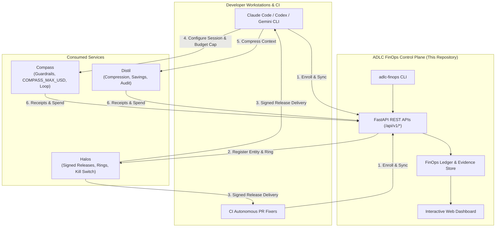

# ADLC FinOps & Governance Control Plane

<div align="center">

### Enterprise AI FinOps, Policy Profiles, and Verification for Coding Agents

**Consuming [Compass](https://github.com/dshakes/compass) • [Distil](https://github.com/dshakes/distil) • [Halos](https://github.com/dshakes/halos)**

[](https://www.python.org/)
[](https://fastapi.tiangolo.com)
[](https://docs.pytest.org/)
[](#finops-unit-economics)
[](LICENSE)

</div>

---

## 🧭 Overview

**ADLC-TokenModules** is an enterprise developer platform and FinOps control plane built on top of three specialized AI coding technologies:

1. Coding-agent configuration, command guardrails (scored 100/100 in CI), hard budget enforcement (`COMPASS_MAX_USD`), review/test/fix loops, and human merge gates.
2. Context compression, recovery, cost measurement (`distil savings`), and context auditing (`distil audit`).
3. Open-source control plane for AI coding CLIs (Claude Code, Codex, Gemini CLI), signed configuration releases, fleet rollout rings (Dark launch → 1% → 5% → 25% → 100% GA), eval-gated promotion, and emergency kill switches.

```
Enterprise AI Developer Platform
│
├── ADLC 1: How coding agents work (guardrails, budget caps, review loops)
├── ADLC 2:  How context is managed and measured (compression, receipts, audits)
└── ADLC 3:   How approved tooling/configuration reaches developers (signed releases, rings)
```

Instead of reinventing guardrail engines, token compressors, or fleet rollout machinery, this platform provides the **authoritative enterprise management layer**:
- **FinOps Controls**: Measures cost per accepted PR, isolates wasted spend on failed loops, reconciles Distil compression receipts with Gateway invoices, and enforces non-bypassable budget ceilings.
- **Unified Onboarding**: Treats the *developer plus repository* as the unit of onboarding with 6-point qualification scorecards.
- **Enterprise Safety**: Bounded task execution, governed MCP tool catalog, fleet posture/drift monitoring, and 10-second signed kill switches.

---

## 🏛️ Architecture



---

## 📁 10 Features (Separated by Directory)

Every feature proposed in the architecture specification is modularized into its own dedicated package under `features/`:

| Feature | Directory | Priority | Key Capabilities |
|---|---|---|---|
| **1. Self-Service Onboarding** | [`features/self_service_onboarding/`](features/self_service_onboarding/) | **P0** | Developer + repo intake wizard, owner confirmation, data classification, Halos fleet enrollment, and Compass bounded verification. |
| **2. Enterprise Policy Profiles** | [`features/enterprise_policy_profiles/`](features/enterprise_policy_profiles/) | **P0** | Approved configurations by repository sensitivity (Confidential, Internal, Public) × Dev environment × Task risk, with Ed25519 signatures. |
| **3. Repository Qualification** | [`features/repository_qualification/`](features/repository_qualification/) | **P0** | Actionable readiness scorecard detecting missing tests, branch protection, unapproved MCP tools, and missing billing owners. |
| **4. Golden-Path Task Catalog** | [`features/golden_path_catalog/`](features/golden_path_catalog/) | **P0** | Repeatable workflows (bug fixes, test gen, dependency updates, refactoring) with Compass iterative review/test/fix loops. |
| **5. Unified Evidence Record** | [`features/unified_evidence_record/`](features/unified_evidence_record/) | **P0** | Tamper-evident ledger linking work item, commit, agent ID, policies, test outcomes, cost, and human merge without leaking secrets. |
| **6. Enterprise Eval Service** | [`features/enterprise_eval_service/`](features/enterprise_eval_service/) | **P1** | Evaluates candidate models/tools on representative internal tasks (pass@k, duration, regressions, cost/task) before ring rollout. |
| **7. Developer AI FinOps Dashboard** | [`features/finops_dashboard_controls/`](features/finops_dashboard_controls/) | **P1** | Unit economics ($/accepted PR, wasted spend), Distil savings ROI, budget cap updates, and 10s emergency kill switch. |
| **8. Governed Plugin Catalog** | [`features/governed_plugin_catalog/`](features/governed_plugin_catalog/) | **P1** | Approved MCP/tool registry with owners, versions, permissions, data destinations, and Compass security scan scores. |
| **9. Fleet Posture & Drift** | [`features/fleet_posture_drift/`](features/fleet_posture_drift/) | **P1** | Detects outdated CLI clients, configuration drift, and unsupported combinations with one-click alignment remediation. |
| **10. SDLC Feedback Loop** | [`features/sdlc_feedback_loop/`](features/sdlc_feedback_loop/) | **P2** | Clusters recurring failure patterns (timeouts, test breaks) and automatically generates reviewed Halos policy improvement PRs. |

---

## ⚡ Quickstart

### 1. Installation

```bash
# Clone the repository
git clone https://github.com/wideanchorgroup/ADLC-TokenModules.git
cd ADLC-TokenModules

# Create virtual environment and install dependencies
python3 -m venv .venv
source .venv/bin/activate
pip install -r requirements.txt
```

### 2. Run the Server & Interactive Web Dashboard

```bash
python run_server.py
```

- **Interactive FinOps Dashboard**: Open [http://localhost:8000/](http://localhost:8000/)
- **Interactive OpenAPI Documentation**: Open [http://localhost:8000/docs](http://localhost:8000/docs)
- **Health Check**: Open [http://localhost:8000/api/health](http://localhost:8000/api/health)

### 3. Run Automated Tests

```bash
source .venv/bin/activate
pytest -v
```

---

## 🖥️ CLI Usage Reference (`adlc-finops`)

The platform provides a CLI for scripting, CI runners, and terminal administration:

```bash
# 1. View high-level FinOps KPIs & budget utilization
python -m adlc_finops.cli finops summary

# 2. Update enterprise monthly budget ceiling
python -m adlc_finops.cli finops budget --cap 50000.0 --scope global

# 3. Trigger emergency kill switch (broadcasts signed kill list within 10s)
python -m adlc_finops.cli finops kill-switch --activate --reason "Investigating prompt injection anomaly"

# 4. Assess repository readiness and actionable blockers
python -m adlc_finops.cli qualify --repo wideanchorgroup/legacy-billing --owner payments-team

# 5. Onboard developer and repository with bounded sanity test
python -m adlc_finops.cli onboard --developer dev_alice --repo wideanchorgroup/auth-service --budget 1200.0 --ring canary_5

# 6. Execute golden-path task with Compass review/fix loop
python -m adlc_finops.cli task --template task-unit-bug --repo wideanchorgroup/ADLC-TokenModules --prompt "Fix validation error in config parser"

# 7. Check agent fleet posture and detect client drift
python -m adlc_finops.cli fleet

# 8. List governed MCP plugins and security scan ratings
python -m adlc_finops.cli plugins
```

---

## 📊 FinOps Unit Economics & Spend Controls

The platform implements empirical FinOps controls:

1. **Cost per Accepted PR**:
   $$\text{Cost per Accepted Task} = \frac{\sum \text{Net Task Spend (USD)}}{\max(1, \text{Accepted Tasks})}$$
2. **Wasted Spend Ratio**:
   $$\text{Wasted Spend Ratio} = \left(\frac{\sum \text{Cost of Failed or Halted Tasks}}{\sum \text{Total Net Spend}}\right) \times 100$$
3. **Distil Context Compression ROI**:
   Measures verified token reductions against compression service overhead, guaranteeing $\ge 97\%$ decision fidelity before aggressive modes are permitted.
4. **Three-Tier Non-Bypassable Budget Caps**:
   - **Tier 1**: Global Enterprise Monthly Cap ($50,000 default).
   - **Tier 2**: Repository / Cost-Center Allocation ($500 – $2,500).
   - **Tier 3**: Per-Session Agent Hard Cap (`COMPASS_MAX_USD`, $1.50 – $15.00), which stops execution before excess spend occurs.

---

## 📚 In-Depth Documentation

Comprehensive technical documentation is maintained in the [`doc/`](doc/) directory:

- 📖 **[Architecture Specification](doc/architecture.md)**: Deep dive into the layered platform topology, security boundaries, and "What We Do Not Assume".
- 💰 **[FinOps Controls & Unit Economics Specification](doc/finops_specification.md)**: Mathematical formulas, ledger schemas, and Gateway reconciliation.
- 🔌 **[API Integration Guide](doc/api_integration_guide.md)**: Detailed contracts for consuming Compass, Distil, and Halos APIs.
- 📋 **[10 Features Detailed Matrix](doc/feature_matrix.md)**: Exhaustive breakdown of requirements, components, inputs, outputs, and priorities.
- 🚀 **[Deployment & Operations Guide](doc/deployment_operations.md)**: Production systemd, Docker, Kubernetes, and monitoring configurations.

---

## 🔒 Security & Privacy Guarantees

- **Zero Secret Logging**: The Unified Evidence Record stores commit SHAs, author IDs, tool hashes, and cost receipts—never private source blobs, raw developer prompts, or credentials.
- **Ed25519 Signed Releases**: Halos verifies policy integrity cryptographically before any agent tool executes.
- **Human Merge Gate**: Compass enforces human merge control by default: *"you always merge"*.

---

<div align="center">
  <sub>Built for engineering organizations adopting AI coding agents with financial rigor and safety.</sub>
</div>
