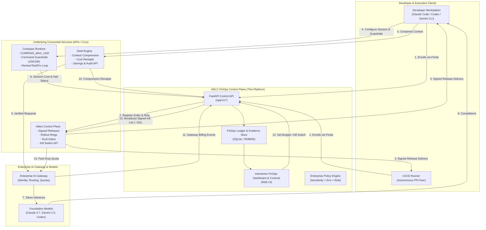
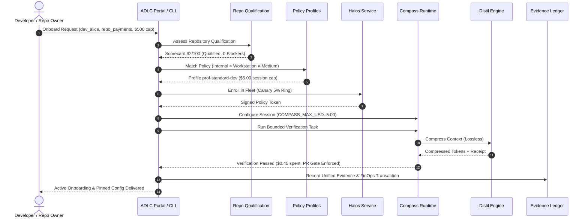

# Architecture Specification: ADLC FinOps & Governance Control Plane

> **Author**: Platform Architecture Team  
> **Status**: Approved / In Production  
> **Target Audience**: Enterprise Architects, FinOps Practitioners, Platform Engineers, Security Reviewers  
> **Underlying Services**: [Compass](https://github.com/dshakes/compass), [Distil](https://github.com/dshakes/distil), [Halos](https://github.com/dshakes/halos)

---

## 1. Executive Summary & Vision

The **ADLC FinOps & Governance Control Plane** is an enterprise developer platform that sits on top of three specialized developer tooling technologies:
1. **Compass**: Governed coding-agent execution, command guardrails, session budget ceilings (`COMPASS_MAX_USD`), and review/test/fix loops.
2. **Distil**: Context compression, recovery, context auditing (`distil audit`), and empirical cost receipts (`distil savings`).
3. **Halos**: Progressive delivery control plane for AI coding CLIs (Claude Code, Codex, Gemini CLI), signed configuration releases, fleet rollout rings, evaluation gates, and emergency kill switches.

Rather than recreating existing guardrail engines, token compressors, or rollout machinery, this platform provides the **authoritative enterprise governance and FinOps control layer**. It treats the developer plus repository as the foundational unit of onboarding, meters unit economics (cost per accepted pull request), enforces non-bypassable budget ceilings, and aggregates verifiable engineering evidence.

```
Enterprise AI Developer Platform
│
├── Compass: How coding agents work (guardrails, budget caps, review loops)
├── Distil:  How context is managed and measured (compression, receipts, audits)
└── Halos:   How approved tooling/configuration reaches developers (signed releases, rings)
```

---

## 2. High-Level Architecture Topology

The following diagram illustrates how developers, CI runners, policy repositories, and the three underlying services interact through the ADLC FinOps Control Plane.



---

## 3. What Each Project Contributes

| Project | What It Already Provides | Architectural Role in ADLC | How ADLC Consumes It |
|---|---|---|---|
| **Compass** | Coding-agent configuration, command guardrails scored 100/100, hard budget enforcement (`COMPASS_MAX_USD`), self-fixing review/test/fix loops, plugin scanning, human merge gate. | Governed coding-agent execution and development workflows. | Injects enterprise session budget ceilings, blocks destructive commands, checks plugin manifests, and triggers bounded verification tasks. |
| **Distil** | Context compression and recovery, context auditing (`distil audit`), cost measurement (`distil savings`), shadow comparisons, SDK/proxy wrappers. | Context efficiency and measurement. | Enforces compression policies, collects empirical cost receipts, reconciles token savings against Gateway bills, and verifies decision fidelity. |
| **Halos** | Control plane for AI coding CLIs, signed releases (`halo release sign`), fleet rollout rings (dark launch → 1% → 5% → 25% → 100% GA), eval-gated promotion, signed kill switches, rollback PRs. | Coding-agent fleet configuration and progressive delivery. | Provisions fleet cohorts, gates ring promotions based on unit economics and eval matrices, and broadcasts emergency signed kill switch tokens. |

---

## 4. Architectural Boundaries: What We Do Not Assume

The PDF explicitly warns against common false assumptions when combining these technologies. The ADLC FinOps architecture adheres strictly to these boundaries:

1. **Compass guardrails are not a security boundary**:
   - Compass documentation labels the project beta and describes dynamic workflows as research preview.
   - *Architectural Decision*: Compass guardrails prevent accidental destruction (e.g. `rm -rf /`, bad git pushes), but OS-level sandboxing, isolated Dev Containers, and network egress firewalls are required for hard multi-tenant isolation.
2. **Distil compression is not guaranteed financial savings or task-quality preservation**:
   - Distil reports cost-neutral short coding-task results and inconclusive long-session evidence. Fewer tokens do not always equal lower cost if reasoning overhead increases.
   - *Architectural Decision*: ADLC requires full-task outcome measurement (`cost_per_accepted_task` and test suite pass baseline), distinguishing "next-action agreement" from true task completion before applying aggressive compression modes.
3. **Halos support is not uniform across CLIs and environments**:
   - Support matrices include partial enforcement across different CLIs (Claude Code, Codex, Gemini CLI) and unexercised paths in managed clusters.
   - *Architectural Decision*: ADLC maintains a continuous Fleet Posture & Drift dashboard that detects local client version drift and unverified CLI configurations.
4. **Combining the three does not automatically deliver enterprise identity or separation of duties**:
   - *Architectural Decision*: The ADLC Control Plane surrounds the stack with enterprise SSO, role-based access control (RBAC), CODEOWNERS verification, specialist review gates for critical tasks, and zero secret logging in evidence records.

---

## 5. Ten Core Features (Folder Architecture)

In compliance with the system specification, every feature is isolated into its own dedicated package under `features/`:

```
features/
├── self_service_onboarding/       # P0: Developer + repository intake & bounded verification
├── enterprise_policy_profiles/    # P0: Sensitivity × Env × Risk policy engine
├── repository_qualification/      # P0: 6-point repository readiness scorecard
├── golden_path_catalog/           # P0: Repeatable workflows & Compass test/fix loops
├── unified_evidence_record/       # P0: Auditable change record without raw secrets
├── enterprise_eval_service/       # P1: Representative internal task benchmarking
├── finops_dashboard_controls/     # P1: Unit economics, spend ceilings & kill switch
├── governed_plugin_catalog/       # P1: MCP registry, permission audits & lifecycle
├── fleet_posture_drift/           # P1: Agent version drift & remediation
└── sdlc_feedback_loop/            # P2: Failure clustering & automated policy PRs
```

### Feature Interaction Lifecycle



---

## 6. Security & Cryptographic Integrity

1. **Signed Policy Deliveries**:
   - Policies compiled by `features/enterprise_policy_profiles` are hashed and signed using Ed25519 keys (`ed25519:<sig>`).
   - The Halos daemon (`halod`) on client machines and CI runners verifies the cryptographic signature before executing AI coding tools.
2. **Emergency Kill Switch (~10-Second Propagation)**:
   - When triggered via the FinOps Dashboard or CLI, a signed kill token is broadcast to Halos.
   - Halos serves the kill list immediately to enterprise AI gateways, cutting off token inference across all active agent sessions in less than 10 seconds.
3. **Zero Secret Centralization**:
   - `features/unified_evidence_record` captures metadata, commit hashes, model names, tokens saved, test outcomes, and approver IDs.
   - Raw developer prompts, private code blobs, API secrets, and conversational transcripts are explicitly excluded from centralized logging to preserve intellectual property and prevent secret exposure.

---

## 7. Operational Resilience & Failure Modes

- **Compass API Outage**: The platform falls back to locally cached guardrail rules and deterministic session budget limits.
- **Distil Proxy Timeout**: If context compression service is unreachable, requests bypass compression losslessly, falling back to direct Gateway routing while logging the event.
- **Halos Server Disconnection**: Developer CLI clients continue executing under the last verified signed release until the local lease expires.
- **Budget Exhaustion**: When a session spends up to `COMPASS_MAX_USD`, Compass halts the session immediately before generating more tokens, reporting status `halted_budget` to the FinOps ledger.
